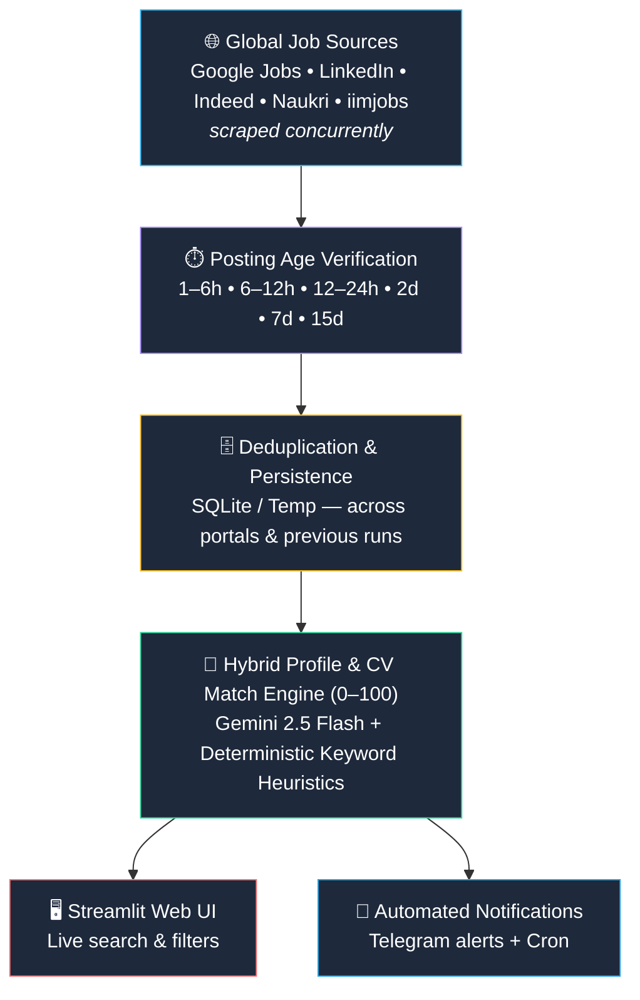

<div align="center">

# ⚡ Autonomous Global Job Hunter Agent

Web Link : https://job-hunter-agent-jobfinder.streamlit.app/

### Your AI-powered job search copilot — sweeping the world's top job portals so you don't have to.

<br>

[](https://www.python.org/)
[](https://streamlit.io/)
[](https://github.com/features/actions)
[](https://ai.google.dev/)
[](https://telegram.org/)
[](LICENSE)
[](#-contributing)

<br>

**Google Jobs** · **LinkedIn** · **Indeed** · **Naukri** · **iimjobs**

*Strict time windows • Full job descriptions • ATS match scores • 1-click apply • Instant Telegram alerts*

<br>

[🚀 Quick Start](#-quick-start) •
[🌟 Features](#-key-capabilities) •
[🏗️ Architecture](#%EF%B8%8F-architecture) •
[☁️ Deploy](#%EF%B8%8F-free-cloud-deployment) •
[⚙️ Configuration](#%EF%B8%8F-configuration--secrets)

</div>

---

## 📖 Overview

**Job Hunter Agent** is an autonomous, multi-portal AI job search agent. It sweeps Google Jobs, LinkedIn, Indeed, Naukri, and executive portals worldwide, enforces your chosen posting window (24h → 30d), extracts the **full job description**, calculates an **ATS match score (0–100)**, optionally aligns your CV, and hands you a **1-click Direct Apply** link — with instant **Telegram alerts** for the best matches.

> 💡 **Zero setup required.** The agent runs out of the box with its built-in heuristic scoring engine. Add API keys only if you want AI deep-scoring and mobile alerts.

---

## 🌟 Key Capabilities

| | Feature | What it does |
|:-:|---|---|
| 🌐 | **Universal Multi-Portal Scraping** | Queries Google Jobs, LinkedIn, Indeed, Naukri, and iimjobs concurrently. Per-platform failure isolation means a rate limit on one portal never blocks the rest. |
| 🌍 | **Worldwide Coverage** | Presets for North America, Europe & UK, Asia Pacific & South Asia, Middle East & Africa, Latin America, and Worldwide Remote — plus custom input for any city, country, or territory. |
| ⏱️ | **Strict Time-Window Verification** | Filter by **24h, 48h, 7d, 15d, 30d**, or any custom day range. Stale reposts are flagged and separated. |
| 🎮 | **Interactive Agent Controls** | Real-time **▶️ Run** and **⏹️ Stop** buttons with live status badges: 🟢 Hunting Jobs · ⚪ Ready / Idle · 🛑 Stopped. |
| 📄 | **Optional CV / Resume Matcher** | Upload a CV (PDF, DOCX, TXT) or paste text to see matched strengths, missing JD keywords, and ATS tailoring suggestions. *Works with or without a CV!* |
| 📱 | **Instant Telegram Alerts** | Send alerts for single vacancies, broadcast top matches, test your connection live, or automate via scheduled sweeps. |
| 🔍 | **Full JD Reader** | Expandable, scrollable in-app viewer showing the employer's complete description next to a **🚀 Direct Apply Now** button. |
| ⭐ | **Hybrid Match Scoring (0–100)** | Powered by the **Gemini 2.5 Flash** free tier, with a zero-cost rule-based heuristic fallback. |

---

## 🏗️ Architecture



---

## 📂 Repository Structure

```text
job-hunter-agent/
├── .github/
│   └── workflows/
│       └── daily_job_hunter.yml   # Twice-daily automated GitHub Actions sweep
├── .gitignore                     # Protects API keys, database, and local cache
├── job_hunter_agent.py            # Main app (Streamlit UI + CLI scraper)
├── requirements.txt               # Lightweight Python dependencies
├── LICENSE                        # MIT Open Source License
└── README.md                      # You are here 👋
```

---

## 🚀 Quick Start

### 1️⃣ Clone the repository

```bash
git clone https://github.com/your-username/job-hunter-agent.git
cd job-hunter-agent
```

### 2️⃣ Create a virtual environment & install dependencies

```bash
python3 -m venv venv
source venv/bin/activate        # Windows: venv\Scripts\activate
pip install -r requirements.txt
```

### 3️⃣ Launch the interactive dashboard

```bash
streamlit run job_hunter_agent.py
```

Open **http://localhost:8501**, pick your region or career domain, and click **▶️ Run Agent**!

### 4️⃣ Or run headless via CLI (cron mode)

```bash
python job_hunter_agent.py --cli --hours 24 --country "India"
```

This generates:

| Output | Description |
|---|---|
| 📝 `latest_jobs_report.md` | Markdown summary table with match scores and direct apply links |
| 📊 `latest_jobs_24h.csv` | Clean tabular data, ready for Excel or Google Sheets |

---

## ☁️ Free Cloud Deployment

<details open>
<summary><b>Option A — Streamlit Community Cloud</b> (free interactive web app)</summary>

<br>

1. Fork or push this repository to your GitHub account.
2. Sign in to [Streamlit Community Cloud](https://streamlit.io/cloud).
3. Click **Create app** → select your repository → set **Main file path** to `job_hunter_agent.py`.
4. Under **Advanced settings**, optionally paste your secrets (`GEMINI_API_KEY`, `TELEGRAM_BOT_TOKEN`, `TELEGRAM_CHAT_ID`).
5. Click **Deploy!** — your dashboard is live with a public URL. 🎉

</details>

<details>
<summary><b>Option B — GitHub Actions</b> (twice-daily automated sweeps)</summary>

<br>

This repo ships with a scheduled workflow at `.github/workflows/daily_job_hunter.yml` that:

- ⏰ Runs automatically every day at **9:00 AM IST** and **6:00 PM IST**
- 🌐 Sweeps all platforms and generates fresh CSV / Markdown reports
- 💾 Commits the reports back to the repository
- 📱 Dispatches top matches to Telegram (if bot secrets are configured)

**Manual trigger:** open your repo on GitHub → **Actions** → **Daily Autonomous Job Hunter Sweep** → **Run workflow**.

</details>

---

## ⚙️ Configuration & Secrets

The agent works with **zero configuration**. To unlock AI deep-scoring and instant mobile alerts, set these environment variables — or add them to **GitHub Secrets** (*Settings → Secrets and variables → Actions*).

| Variable | Description | Required? |
|---|---|:-:|
| `GEMINI_API_KEY` | Google Gemini API key for AI match rationale & deep resume analysis | 🟡 Optional *(falls back to deterministic scoring)* |
| `TELEGRAM_BOT_TOKEN` | Bot token from [@BotFather](https://t.me/BotFather) | 🟡 Optional *(for Telegram alerts)* |
| `TELEGRAM_CHAT_ID` | Numeric chat ID from [@userinfobot](https://t.me/userinfobot) or a channel username | 🟡 Optional *(for Telegram alerts)* |

> 🔒 **Never commit your keys.** The included `.gitignore` already protects API keys, the local database, and cache files.

---

## 💼 Pre-Tuned Industry Presets

| Sector | Roles covered |
|---|---|
| 🧑‍💼 **HR & Talent Acquisition** | Technical Recruiter · Non-IT Recruiter · Executive Search · HRBP · Talent Partner |
| 💻 **Software Engineering & IT** | Full Stack Developer · Frontend (React/Vue) · Backend (Python/Node/Java) · DevOps · Cloud Architect |
| 📈 **B2B Sales & Growth** | Account Executive · Business Development Manager · Inside Sales Specialist · SaaS Sales Lead |
| 💰 **Finance & Accounting** | Financial Analyst · Senior Accountant · Finance Manager · Auditor |
| 📣 **Marketing & Growth** | Growth Marketing Manager · Performance Marketing Specialist · SEO & Content Strategist |
| ✨ **Custom / Any Sector** | Type your own job titles, skills, and target locations right in the UI |

---

## 👤 Author

**Rinku Lodhi** · `@Insideofcub`

Built and maintained by Rinku Lodhi. Feedback, ideas, and collaborations are always welcome!

---

## 🤝 Contributing

Contributions, bug reports, and ideas are always welcome!

1. 🍴 Fork the project
2. 🌿 Create your feature branch — `git checkout -b feature/AmazingFeature`
3. 💾 Commit your changes — `git commit -m 'Add AmazingFeature'`
4. 📤 Push to the branch — `git push origin feature/AmazingFeature`
5. 🔃 Open a Pull Request

---

## 📄 License

Distributed under the **MIT License**. See [`LICENSE`](LICENSE) for more information.

---

<div align="center">

**If this project helps you land your next role, give it a ⭐ — it means a lot!**

Made with ❤️ by **Rinku Lodhi** for job seekers everywhere.

</div>
